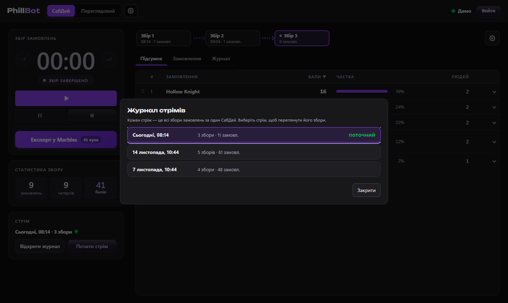

# PhillBot

Програма для Windows, що допомагає вести інтерактив на Twitch-стрімі: глядачі замовляють ігри за бали каналу (**СабДей**),
роблять ставки на аукціоні з колесом (**Переглядовий**) і можуть підтримати донатом через **Donatello**.
Таймер для стріму виводиться віджетом в **OBS**. Усі дані зберігаються на вашому ПК.

## Можливості

### СабДей — замовлення ігор

- Глядач замовляє гру нагородою за бали каналу (зі словом «СабДей» у назві); збір триває 10 хв (±1 хв, пауза).
- **Бали:**
  - підписка — (множник тіру × місяці) / 3 з округленням угору: 1 міс → 1, 4 → 2, 30 → 10, 35 → 12 (множники за замовчуванням 1 / 2 / 3);
  - подаровані сабки за останні 30 днів — +1 бал за кожні 2, остача не рахується (2 → 1, 5 → 2);
  - без підписки — скільки задано в налаштуваннях (за замовчуванням 0).
- Кілька замовлень від одного глядача: рахується перше, останнє або бали діляться між ними.
- Схожі замовлення зливаються перетягуванням рядка, будь-яке можна приховати чи перейменувати.
- Експорт у Marbles on Stream, вибір переможця.
- Кожен старт — новий збір; збори одного стріму й попередні стріми — у **журналі**.

### Гра переможця і голосування

- Таймер гри (за замовчуванням 40 хв) і звук, коли час вийшов (вбудований або свій за посиланням).
- Голосування в чаті: «1» — продовжити гру, «2» — дроп (за замовчуванням 3 хв).
- Голосують лише підписники; на вибір — рахується останній голос глядача або тільки перший.

### Переглядовий — аукціон

- Ставки — до 5 нагород за бали каналу (за замовчуванням 1000 / 5000 / 10000); текст ставки — назва лота.
- Однакові назви додаються до лота, схожі — пропозиція «Додати до існуючого».
- Лоти можна зливати, приховувати, редагувати; останнє злиття можна скасувати.
- Колесо через random.org: «на вибування» (крутить до переможця) або «одразу результат».
  Шанс перемогти дорівнює частці суми лота; міні-колесо видно поруч зі ставками.

### Донати Donatello

- Донат під час збору СабДею стає замовленням (за замовчуванням 30 грн = 1 бал),
  під час аукціону — ставкою (10 грн = 1000 балів).
- Донати приходять миттєво через колбек Donatello; публічну адресу для нього дає вбудований тунель ngrok.

### Віджет для OBS

Один таймер для збору, гри, голосування й аукціону (640×200), під час голосування — «перетягування канату» 1 / 2.
Адреса віджета — у загальних налаштуваннях (шестерня в шапці).

### Дані

- Усе зберігається в `phillbot.db` поруч із `PhillBot.exe`: збори, ставки, журнал і таймери переживають перезапуск.
- Експорт за весь час: СабДей .csv, аукціон .csv або все разом .zip.
- **Імпорт:** шестерня → «Дані за весь час» → «Імпортувати дані…» → файл `.db` (з іншого ПК або з вебверсії) → канал.
  Дані з файлу замінюють дані на ПК; попередні спершу зберігаються в `phillbot.before-import-<дата>.db`.
  Налаштування цього ПК (OBS, ngrok, Donatello, чат) не змінюються.

## Як почати

1. Завантажте `PhillBot.exe` з [Releases](../../releases) і покладіть у свою теку (не в архів чи «Завантаження»).
2. Створіть застосунок на [dev.twitch.tv/console/apps](https://dev.twitch.tv/console/apps): Redirect URL `http://localhost`,
   Client Type **Public**. Вставте Client ID у програму й увійдіть під акаунтом каналу.
3. Створіть нагороди за бали каналу з обов'язковим текстом: для СабДею (зі словом «СабДей» у назві) і для аукціону.
4. Шестерня в шапці → скопіюйте адресу віджета й додайте в OBS як «Браузер» 640×200.
5. За бажанням — Donatello: токен ngrok і ключ колбека в налаштуваннях, а посилання з програми — у Donatello → API → Колбеки.
6. Переходите з вебверсії чи іншого ПК — імпортуйте свої дані (див. «Дані»).

Потрібно: Windows 10/11 (WebView2), для СабДею — Marbles on Stream (Steam).
Налаштування, вхід і історія зберігаються поруч з exe — передавайте іншим лише сам `PhillBot.exe`.

## Збірка

- Програма: Go + [Wails](https://wails.io) (`app/`), `wails build` → `app/build/bin/PhillBot.exe`.
- Тег `vX.Y.Z` → GitHub Actions збирає `PhillBot.exe` і публікує його в Releases.
- Вебверсія для кількох стрімерів (вхід через Twitch, сторінка для глядачів) збирається з того самого коду
  з тегом `server` — як розгорнути, див. [docs/DEPLOY.md](docs/DEPLOY.md).
