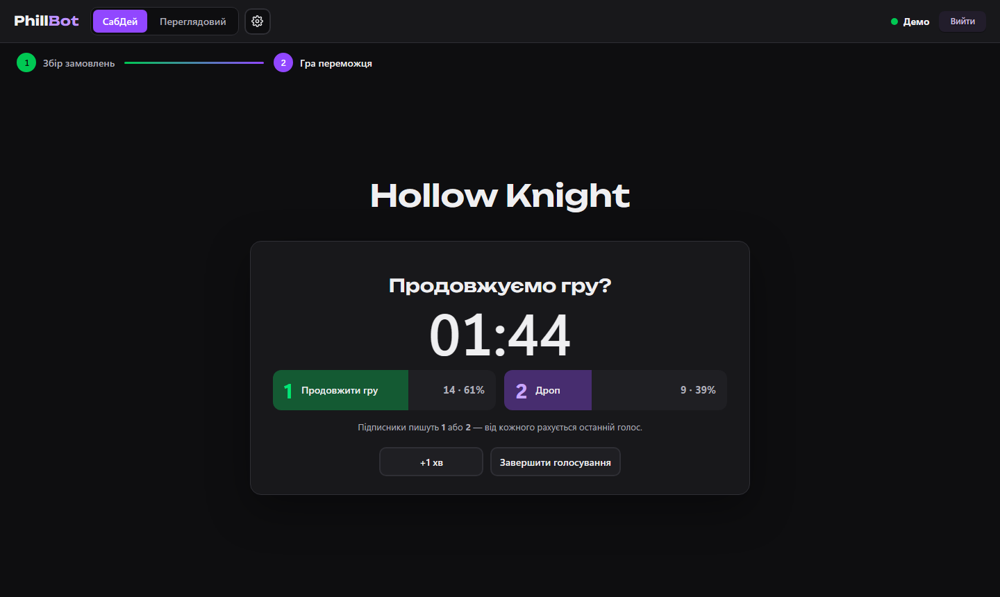
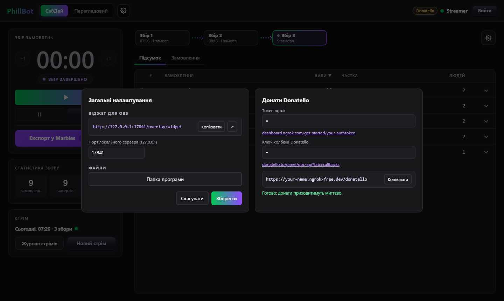

# PhillBot

Програма для Windows, що допомагає вести інтерактив на Twitch-стрімі: глядачі замовляють ігри за бали каналу (**СабДей**),
роблять ставки на аукціоні з колесом (**Переглядовий**) і можуть підтримати донатом через **Donatello**.
Таймер для стріму виводиться віджетом в **OBS**.

## Можливості

**СабДей — замовлення ігор**
- Глядачі замовляють гру нагородою за бали каналу; таймер збору 10 хв (±1 хв, пауза).
- Бали: тір підписки × місяці; +1 за кожну подаровану сабку за 30 днів.
- Кілька замовлень від одного глядача — на вибір: перше, останнє або бали діляться між ними.
- Схожі замовлення зливаються перетягуванням рядка.
- Експорт у Marbles on Stream, вибір переможця, гра з таймером і голосування в чаті: «1» — продовжити, «2» — дроп.

**Переглядовий — аукціон**
- Ставки — до 5 нагород за бали каналу (за замовчуванням 1000 / 5000 / 10000); текст ставки — назва лота.
- Однакові назви додаються до лота, схожі — пропозиція «Додати до існуючого».
- Лоти можна зливати, приховувати, редагувати.
- Колесо через random.org: «на вибування» (крутить саме до переможця) або «одразу результат».
  Шанс перемогти завжди дорівнює частці суми лота.

**Донати Donatello**
- Донат під час збору СабДею стає замовленням (за замовчуванням 30 грн = 1 бал), під час аукціону — ставкою (10 грн = 1000 балів).
- Донати приходять миттєво через колбек Donatello; публічну адресу дає вбудований ngrok.

**Віджет для OBS** — один таймер для збору, гри, голосування й аукціону (640×200).

## Як почати

1. Завантажте `PhillBot.exe` з [Releases](../../releases) і покладіть у свою теку (не в архів чи «Завантаження»).
2. Створіть застосунок на [dev.twitch.tv/console/apps](https://dev.twitch.tv/console/apps): Redirect URL `http://localhost`,
   Client Type **Public**. Вставте Client ID у програму й увійдіть під акаунтом каналу.
3. Створіть нагороди за бали каналу з обов'язковим текстом: для СабДею (зі словом «СабДей» у назві) і для аукціону.
4. Шестерня в шапці → скопіюйте адресу віджета і додайте в OBS як «Браузер» 640×200.
5. За бажанням — Donatello: токен ngrok і ключ колбека в налаштуваннях, а посилання з програми — у Donatello → API → Колбеки.

Потрібно: Windows 10/11 (WebView2), для СабДею — Marbles on Stream (Steam).
Налаштування, вхід і історія зберігаються поруч з exe — передавайте іншим лише сам `PhillBot.exe`.
X.Y.Z` → GitHub Actions збирає `PhillBot.exe` і публікує його в Releases.
