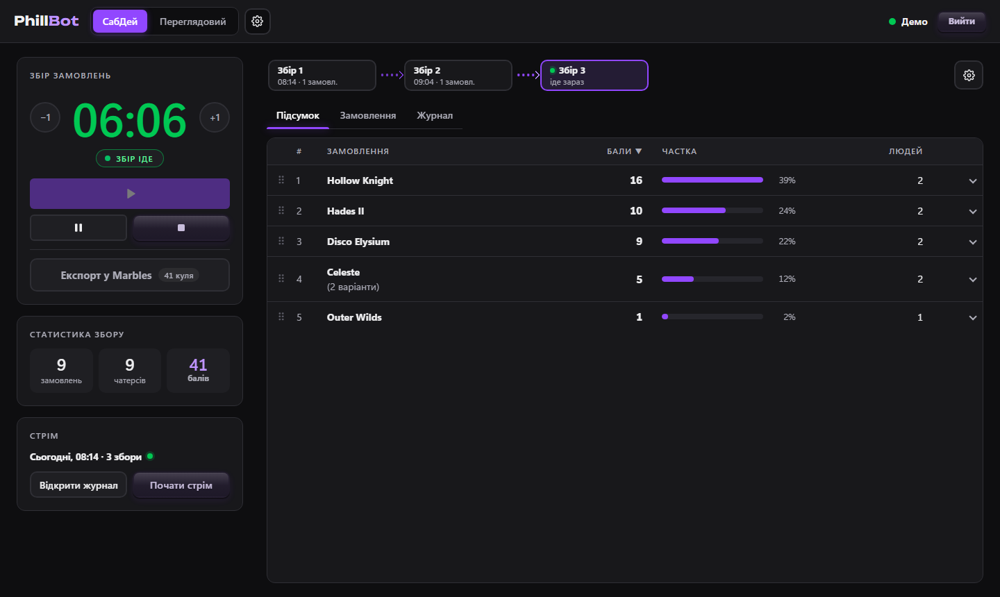
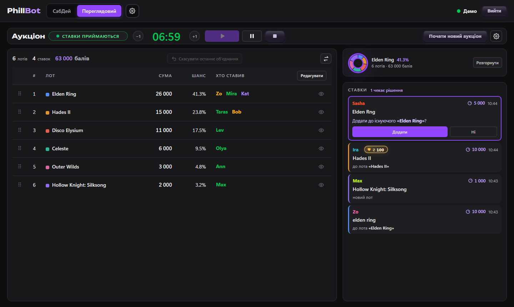
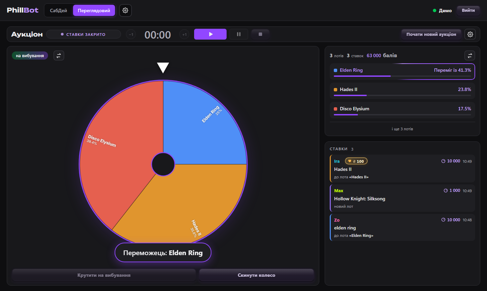
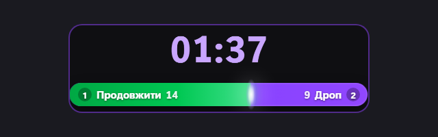
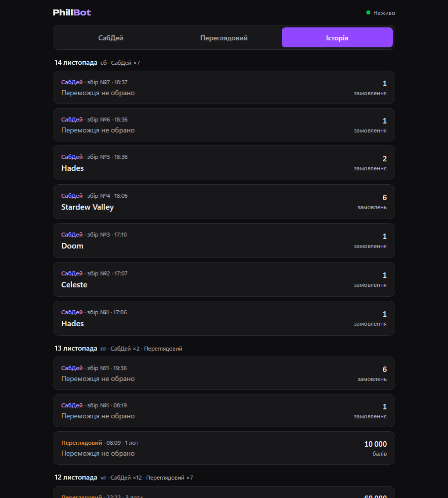

# PhillBot

Інструмент для інтерактиву на Twitch-стрімі: глядачі замовляють ігри за бали каналу (**СабДей**),
роблять ставки на аукціоні з колесом (**Переглядовий**) і можуть підтримати донатом через **Donatello**.
Таймер для стріму виводиться віджетом в **OBS**, а глядачі бачать перебіг на окремій сторінці без входу.

Працює в браузері: **[phillbot.fly.dev](https://phillbot.fly.dev)** — вхід через Twitch.
Подивитися без входу: **[phillbot.fly.dev/demo](https://phillbot.fly.dev/demo)** (дані вигадані, нічого не зберігається).

## Можливості

### СабДей — замовлення ігор

- Глядач замовляє гру нагородою за бали каналу (зі словом «СабДей» у назві); збір триває 10 хв (±1 хв, пауза).
- **Бали:**
  - підписка — (множник тіру × місяці) / 3 з округленням угору: 1 міс → 1, 4 → 2, 30 → 10, 35 → 12 (множники за замовчуванням 1 / 2 / 3);
  - подаровані сабки за останні 30 днів — +1 бал за кожні 2, остача не рахується (2 → 1, 5 → 2);
  - без підписки — скільки задано в налаштуваннях (за замовчуванням 0).
- Кілька замовлень від одного глядача: рахується перше, останнє або бали діляться між ними.
- Схожі замовлення зливаються перетягуванням рядка, будь-яке можна приховати чи перейменувати.
- Експорт у Marbles on Stream, вибір переможця.
- Кожен старт — новий збір; збори одного стріму й попередні стріми — у **журналі**.

### Гра переможця і голосування

- Таймер гри (за замовчуванням 40 хв) і звук, коли час вийшов (вбудований або свій за посиланням).
- Голосування в чаті: «1» — продовжити гру, «2» — дроп (за замовчуванням 3 хв).
- Голосують лише підписники; на вибір — рахується останній голос глядача або тільки перший.

### Переглядовий — аукціон

- Ставки — до 5 нагород за бали каналу (за замовчуванням 1000 / 5000 / 10000); текст ставки — назва лота.
- Однакові назви додаються до лота, схожі — пропозиція «Додати до існуючого».
- Лоти можна зливати, приховувати, редагувати; останнє злиття можна скасувати.
- Колесо через random.org: «на вибування» (крутить до переможця) або «одразу результат».
  Шанс перемогти дорівнює частці суми лота; міні-колесо видно поруч зі ставками.

### Донати Donatello

- Донат під час збору СабДею стає замовленням (за замовчуванням 30 грн = 1 бал),
  під час аукціону — ставкою (10 грн = 1000 балів).
- Донати приходять миттєво через колбек: посилання для Donatello → API → Колбеки — у налаштуваннях.

### Віджет для OBS

Один таймер для збору, гри, голосування й аукціону (640×200), під час голосування — «перетягування канату» 1 / 2.
Посилання — у загальних налаштуваннях (шестерня в шапці).

### Сторінка для глядачів

Одне посилання без входу: поточний СабДей (таймер, замовлення, бали) або Переглядовий (лоти з шансами),
голосування наживо й **історія** — минулі збори й аукціони за датами з переможцями.
У посиланні — випадковий код, а не нік, тож чужі сторінки не знайти перебором.
Пряме посилання на вкладку: `…#history`, `…#auction`.

### Дані й приватність

- Усе зберігається на сервері: збори, ставки, журнал і таймери переживають перезапуск.
- Експорт за весь час: СабДей .csv, аукціон .csv або все разом .zip.
- «Видалити мої дані» в налаштуваннях стирає все про канал; якщо доступ Twitch відкликано і стрімер не входить 30 днів — дані видаляються самі.
  Деталі — на сторінках [Конфіденційність](https://phillbot.fly.dev/privacy) і [Умови](https://phillbot.fly.dev/terms).

## Як почати

1. Увійдіть на [phillbot.fly.dev](https://phillbot.fly.dev) акаунтом каналу. Доступ — за списком: якщо вас немає, напишіть адміністратору.
2. Створіть нагороди за бали каналу з обов'язковим текстом: для СабДею (зі словом «СабДей» у назві) і для аукціону.
3. Шестерня в шапці → скопіюйте посилання віджета й додайте в OBS як «Браузер» 640×200.
4. Там само — посилання «Сторінка для глядачів»: його можна закріпити в чаті чи панелі каналу.
5. За бажанням — Donatello: посилання колбека з налаштувань у Donatello → API → Колбеки.

Для СабДею потрібен Marbles on Stream (Steam).

## Власний сервер

Сервер — Go (тег збірки `server`) з базою SQLite або PostgreSQL; образ — `app/Dockerfile`.
Як розгорнути (Fly.io або інший хостинг, змінні оточення, застосунок Twitch) — [docs/DEPLOY.md](docs/DEPLOY.md).
